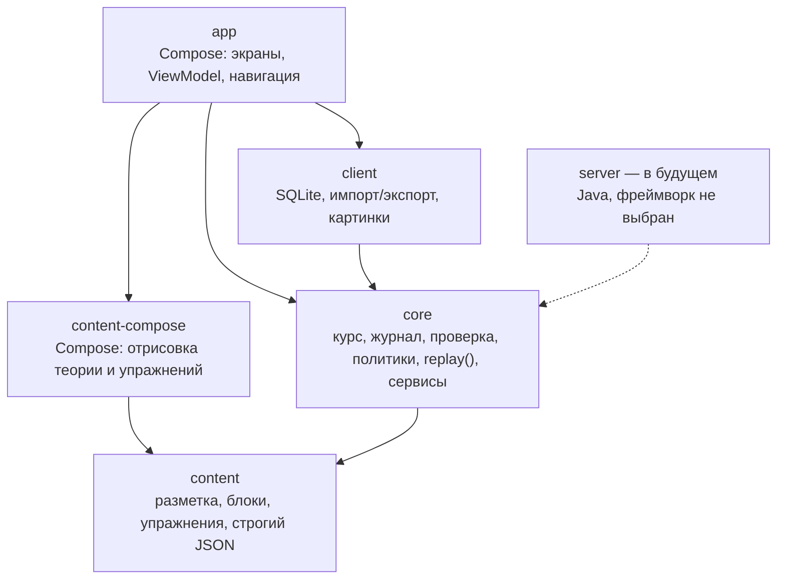
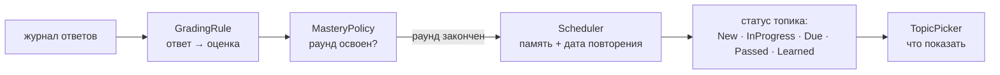

# Архитектура Polylingy

Архитектура приложения на Kotlin Multiplatform: что сделано (десктоп, версия 0.2) и куда идём (другие платформы, сервер,
синхронизация).

Статус: ноябрь 2026, версия 0.2.0. Сделаны модули `content`, `content-compose`, `core`, `client` и `app` для десктопа;
остальное — концепция. Решения, помеченные «не решено», сознательно отложены.

Подробности вынесены в отдельные документы:
- [`content-format.md`](content-format.md) — формат курса: теория, упражнения, объяснения, импорт, проверка, `formatVersion`;
- [`learning-model.md`](learning-model.md) — модель обучения: раунды, оценки, политики курса, проверка ответов и опечатки;
- [`testing.md`](testing.md) — как проверяются изменения;
- [`migration-plan.md`](migration-plan.md) — как переписывали приложение на эту модель (этапы 1–8, решения по ходу).

---

## 1. Что это за приложение

Polylingy — приложение для изучения языков с интервальным повторением, как Anki, но с упором на гибкость упражнений
и правил повторения.

- Работает **офлайн**: все данные пользователя лежат локально.
- **Курс** состоит из **юнитов** (необязательно) с **теорией**, юнит — из **топиков**, топик — из нескольких **упражнений**
  разных типов. Повторяется топик; упражнение внутри него каждый раз выбирается случайно.
- Курс без юнитов — **плоский**: просто список топиков (например, неправильные глаголы).
- В будущем: несколько устройств и синхронизация через сервер.

## 2. Главные принципы

1. **Одна бизнес-логика на все платформы.** Правила обучения пишутся один раз в `core` и одинаково работают на десктопе,
   телефоне и сервере.
2. **Ядро ни от чего не зависит.** В `core` нет UI, SQL, HTTP и файлов. Всё внешнее ядро получает через интерфейсы
   (порты), реализации дают платформы.
3. **Два вида данных:**
   - **контент** (курсы) — документы с версией, хранятся и меняются целиком;
   - **обучение** (ответы) — неизменяемый журнал событий.
4. **Прогресс не хранится, а вычисляется** из журнала текущими правилами курса. Поменял правила — пересчитал историю.
5. **Абстракции — по согласованным интерфейсам.** Четыре политики обучения, проверка упражнений, отрисовка блоков —
   каждая за своим интерфейсом; новый тип упражнения или блока добавляется в известных местах (раздел 5).
6. **Сначала просто.** Делаем то, что нужно сейчас; будущее описано концептуально и заранее не строится.

## 3. Модули



Стрелка — «зависит от». Все зависимости направлены к `core` и `content`.

| Модуль | Что внутри | Состояние |
|---|---|---|
| `content` | содержимое курса, независимое от остального: разметка `Inline`, блоки теории, типы упражнений, ответы и результаты пунктов, `validate()`, строгий JSON (`ContentJson`) | сделано |
| `content-compose` | отрисовка содержимого: `ContentView` (блоки), `ExerciseView` (все типы упражнений), `ContentTheme`, `ImageLoader`, `LinkNames`; ничего не знает о курсах и проверке | сделано |
| `core` | модель курса и его файл (`CourseJson`), журнал, проверка ответов, четыре политики и наборы, `replay()`, порты, `CourseService` / `StudyService` | сделано |
| `client` | реализации портов: SQLite (`LocalStorage`), импорт и экспорт с картинками (`CourseLibrary`), пример курса; в `desktopMain` — zip, файлы картинок, HTTP, путь к базе | сделано |
| `app` | экраны, ViewModel, навигация, `AppContainer`; в `desktopMain` — `main()` и нативные диалоги файлов | сделано, только десктоп |
| `server` | REST, хранение журналов и курсов, приём синка | только концепция |
| веб | — | только концепция |

Корневой пакет — `com.polylingy`.

### Структура репозитория

```
polylingy/
├── settings.gradle.kts, build.gradle.kts, gradle/libs.versions.toml, gradle.properties (версия)
├── content/src/commonMain/kotlin/com/polylingy/content/
│     Inline, Block (Content), Exercise, Response, Media, Problem, ContentJson, Walk
├── content-compose/src/commonMain/kotlin/com/polylingy/content/compose/
│     Blocks, Exercises, BlanksViews, ChoiceMatchOrderViews, InlineText, Theme
├── core/src/commonMain/kotlin/com/polylingy/core/
│   ├── content/     Course, CourseJson (чтение и запись файла), CourseValidation, RulesSpec, CourseService
│   ├── journal/     EventEnvelope, AnswerSubmitted, ZonedInstant
│   ├── rules/       TextMatcher, ExerciseChecker (проверка ответов)
│   ├── learning/    Policies (интерфейсы), StandardPolicies, Presets, Replay
│   ├── study/       StudyService: что показать, ответ, прогресс для экранов
│   └── ports/       CourseRepository, EventLog, Clock
├── client/src/{commonMain, desktopMain}/   LocalStorage, CourseLibrary; CourseArchive, FileImageStore, DesktopStorage
├── app/src/{commonMain, desktopMain}/      courses/, course/, study/, ui/; Main.kt, DesktopCourseFiles
├── examples/        настоящие курсы для ручной проверки (zip с картинками, плоский json)
├── scripts/         relaunch.ps1
└── docs/
```

## 4. Ядро и порты

```kotlin
interface CourseRepository {
    fun all(): List<Course>
    fun get(id: Uuid): Course?
    fun save(course: Course)
    fun delete(id: Uuid)
}

interface EventLog {
    fun append(event: EventEnvelope)
    fun all(): List<EventEnvelope>
}

fun interface Clock {
    fun now(): ZonedInstant           // момент + часовой пояс устройства
}
```

Реализации живут вне ядра: на клиенте — SQLite (`client`), на сервере будет своя БД, в тестах — в памяти.

Сценарии использования тоже в ядре, экраны вызывают только их:
- **`CourseService`** — импорт (копия с новыми id, если id уже заняты; уникальное название «(2)»), правка названия
  и описания, удаление. Каждое сохранение — новая `revision`.
- **`StudyService`** — `progress()` (статус каждого топика и счётчики), `next()` (что показать по правилам курса),
  `practise()` (топик, выбранный учеником), `answer()` (проверка, запись в журнал, статус до и после), `theoryFirst()`.

## 5. Контент: документы курсов

Курс — **документ**: один целостный объект, который сохраняется целиком. Полный формат — в `content-format.md`.

```kotlin
data class Course(
    val formatVersion: Int,
    val id: Uuid, val name: String, val description: Inline?,
    val createdAt: Instant, val revision: Int, val updatedAt: Instant,
    val theme: Theme?,                 // акцентный цвет курса
    val settings: CourseSettings,      // allowTypos
    val rules: RulesSpec?,             // набор политик + замены
    val units: List<CourseUnit>,       // или…
    val topics: List<Topic>,           // …плоский курс
)
data class CourseUnit(val id: Uuid, val title: String, val subtitle: Inline?, val theory: Content?, val topics: List<Topic>)
data class Topic(val id: Uuid, val title: String, val explanation: Content?, val exercises: List<Exercise>)
```

- **Теория и объяснения** — `Content`: страница из смысловых блоков (раздел, текст, ситуация, картинка, таблица, цитата,
  примеры, слова, совет, «см. также»). Размеров в JSON нет: раскладка — дело приложения.
- **Упражнения** шести типов: пропуски, выбор, картинки, таблица, соответствия, порядок слов. Тип — у упражнения целиком.
  Новый тип: класс в `content` с `validate()`, вид в `content-compose`, чекер в `core`, образец в тестах.
- **Ссылки на теорию** — по `id` раздела (UUID, уникален в курсе), а не по букве.
- **Все id — UUID.** Недостающие генерируются при импорте; повторный импорт создаёт копию со своими id.
- **`formatVersion`**: файл своей или более старой версии читается строго (незнакомое — ошибка с путём), более новой —
  мягко: курс можно изучать, но не править и не экспортировать; незнакомые части пропускаются.
- **Конфликты (когда появится синк):** побеждает документ с большей `revision`, при равенстве — с более поздним
  `updatedAt`. Документ заменяется целиком.

## 6. Обучение: журнал событий

Каждый ответ — событие, которое дописывается в журнал и **никогда не меняется**.

```kotlin
data class EventEnvelope(
    val eventId: Uuid,                // повторная отправка при синке не создаст дубль
    val deviceId: Uuid,
    val occurredAt: ZonedInstant,
    val schemaVersion: Int,           // сейчас 1
    val event: Event,
)

data class AnswerSubmitted(
    val courseId: Uuid, val topicId: Uuid, val exerciseId: Uuid,
    val courseRevision: Int,          // какая версия упражнения была на экране
    val response: Response,           // что ввёл ученик
    val results: List<ItemResult>,    // по пункту: CORRECT / TYPO / WRONG
) : Event
```

- **Журнал хранит факты, а не оценки.** Засчитан ли ответ, сдан ли топик, когда повторять — выводится из `results`
  текущими политиками. Старые ответы заново не проверяются: правка упражнения не переписывает прошлое.
- **Формат развивается через `schemaVersion`;** старые версии всегда читаются.
- **Время с часовым поясом** (`ZonedInstant`): «какой это был день» одинаков на любом устройстве.
- **Удаление курса или топика не трогает журнал.** События удалённого контента пропускаются при пересчёте.

## 7. Как вычисляется прогресс

Подробно, с примерами — в `learning-model.md`. Коротко:



- **Четыре политики** с общим типом оценки `G` (несовпадающий набор не скомпилируется): оценка ответа, освоение раунда,
  расписание, выбор топика. Курс выбирает **набор** (`quick`, `ladder` — по умолчанию, `sm2`) и может заменить части.
- **Раунд** — путь топика от первого ответа до освоения. Повторение — новый раунд в фазе `REVIEW`.
- **Статусы:** `New`, `InProgress` (раунд идёт), `Due` (пора повторить), `Passed(due)` (отдыхает до даты),
  `Learned` (выучен навсегда, сам не вернётся). На экране: New · Learning · To review today · Back on … · Learned for good.
- **Группы для экранов** (`TopicGroup`): new, learning, to review, learned, learned for good — из памяти и раунда;
  `ProgressCounts` считает их и новые, доступные сегодня по дневному лимиту курса (`settings.newPerDay`, нет поля — нет лимита).

```kotlin
fun <M, G> replay(course: Course, events: List<EventEnvelope>, rules: CourseRules<M, G>): Map<Uuid, TopicState<M, G>>
```

> **TODO(perf): узкое место.** Весь журнал пересчитывается при каждом запросе. Это просто и всегда верно, но станет
> медленным на десятках тысяч событий. Замена — проекция прогресса, которую можно в любой момент пересобрать из журнала.

## 8. Клиент: хранение

```
<Documents>/polylingy/
  polylingy.db        course_document, journal_event, setting
  images/<courseId>/  картинки курса: images/… из архива, remote/<hash> скачанные по URL
  logs/               polylingy.log, файл в день, 14 дней
```

- **SQLite через SQLDelight.** Схема на SQL, Kotlin генерируется. Курс хранится целиком как JSON — тот же формат, что
  в файле курса; событие — конверт плюс тело в JSON. Формат развивается без миграций таблиц.
- **Импорт:** `course.json` (картинки только по `https://`) или zip с `course.json` и `images/`. Картинки по URL
  скачиваются при импорте; курс работает без сети. **Экспорт:** zip, если у курса есть свои картинки, иначе json.
- **Нечитаемый сохранённый курс** (формат поменялся во время разработки) не роняет список: он показывается
  с ошибкой и его можно удалить (`LocalStorage.brokenCourses()`).
- **Пример курса** импортируется при первом запуске, когда курсов нет.
- **Логи** — kotlin-logging + logback; действия пользователя пишутся на уровне INFO.

## 9. Приложение: экраны и платформы

- **Экраны на Compose Multiplatform:** список курсов → курс (юниты или топики) → юнит → теория / упражнение /
  страница топика; «на сегодня всё». Стиль «Notebook»: бумажный фон, мягкий зелёный, акцент курса только для его значка
  и кнопок; цвета статусов одинаковы во всех курсах.
- **Состояние** — `ViewModel` и Navigation для Compose Multiplatform; **сборка объектов** — вручную в `AppContainer`.
- **Отрисовка содержимого** — `content-compose`; экран передаёт ему цвета курса, загрузчик картинок и имена ссылок.

| Слой | Общий код | Платформенный код |
|---|---|---|
| Экраны, навигация, ViewModel | ✓ | — |
| Хранилище, импорт/экспорт | ✓ (логика) | драйвер SQLite, zip, файлы картинок, HTTP, диалоги файлов |
| Декодирование картинок | интерфейс `ImageDecoder` | Skia на десктопе |
| Точка входа и сборка | — | `main()`, окно; `.msi` / `.dmg` / `.deb` |

**Поддерживается только десктоп**, собирается и проверяется только Windows. Установщик пока не проверяем:
собираем и запускаем локально (`scripts/relaunch.ps1`).

**В будущем (концепция):** Android (`androidMain`), iOS (Kotlin/Native + Xcode, нужен Mac), веб (технология не выбрана:
тонкий клиент к серверу или ядро в JS).

## 10. Сервер и синхронизация (концепция)

Сервер **не реализуется**. Зафиксированы идеи:

- Сервер на Java, фреймворк не выбран, предпочтение — лёгкие библиотеки. Ядро подключается как JVM-библиотека.
- **Журнал синхронизируется дописыванием:** клиент отправляет новые события и получает чужие «после номера N»,
  дубли отсекаются по `eventId`. Конфликтов нет.
- **Курсы синхронизируются целиком** по правилу из раздела 5.
- Прогресс вычисляется тем же `replay()` и на клиенте, и на сервере.

## 11. Узкие места и долги

| Что | Почему пока так | Чем заменить |
|---|---|---|
| Полный пересчёт журнала при каждом запросе | проще всего и всегда верно | проекция прогресса, пересобираемая из журнала |
| Удалённые курсы физически удаляются | синка пока нет | метка «удалён» (tombstone) |
| База в `<Documents>/polylingy`, а «Документы» часто синхронизирует OneDrive | так было изначально | `%LOCALAPPDATA%`: облачная синхронизация может повредить SQLite |
| Запросы к БД и импорт (со скачиванием картинок) идут в UI-потоке | данных мало | фоновый поток, когда появятся задержки |
| Шрифт системный (Segoe UI), а не Inter из макетов | не тащим файлы шрифтов | встроить Inter в ресурсы |
| Markdown и HTML как формат `Content` | хватает блоков | добавить форматы, когда курсу понадобится |
| Настройки и политики курса лежат в файле курса | автор курса ими управляет | возможно, перенести в таблицу; решать после работы с настоящими курсами (`migration-plan.md`, раздел 9) |
| Ссылки `unit` в упражнениях незнакомого типа не переводятся при копии курса | такие упражнения хранятся как сырой JSON | — |

## 12. Принятые решения о поведении

Неочевидные правила, которые легко случайно поменять:

- **Итог проверки не выдаёт политику.** Строка проверки — только из результатов пунктов («All correct», «1 mistake · 1 typo»);
  строка прогресса — только из статуса до и после («Topic passed — next review …», «Topic learned for good»).
- **Опечатка** — одна замена или перестановка соседних букв в слове от 4 букв, не больше одной на пункт; включается
  `settings.allowTypos` (по умолчанию да) и засчитывается как верный ответ.
- **Ответ в пропуске — не длиннее 40 символов;** поле дальше не принимает, длинный вариант — ошибка импорта.
- **Объяснение и пометки к пунктам** показываются после каждой проверки, и при верном ответе тоже. Объяснение топика
  заменяет объяснение упражнения, если своего у упражнения нет.
- **Новый юнит** сначала показывает теорию, потом упражнения; дальше теория — по кнопке.
- **Порядок по умолчанию** (`ReviewsFirst`): начатый раунд, потом повторения, потом новые — по порядку курса.
  `random` — повторения, потом новые в случайном порядке.
- **Досрочная практика** (`StudyService.practise`) начинает новый раунд и планирует топик заново от сегодня.
  Кнопка «Extra practice» на экранах — пока заглушка.
- **События с одинаковым временем** пересчитываются в порядке записи.
- **Повторный импорт** создаёт копию с новыми id и названием «(2)» — топик не может принадлежать двум курсам.
- **SM-2 зафиксирован эталоном:** `Sm2GoldenTest` сверяет 856 сдач с первой версией приложения.

## 13. Не решено

- **Самооценка и «Я был прав — засчитать»** — отложены; лягут новым необязательным полем события и правилом оценки.
- **Что делает «Extra practice»** — считать ли, переносить ли расписание.
- **Управление курсами:** редактор, добавление топиков (кнопка «Add topic» — заглушка), обновление курса повторным импортом.
- **Сервер:** версия Java, фреймворк, БД, авторизация. **Веб:** технология и роль.
