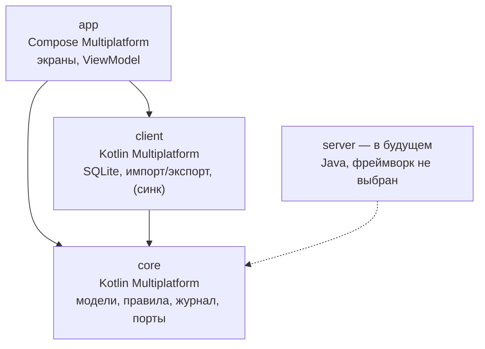
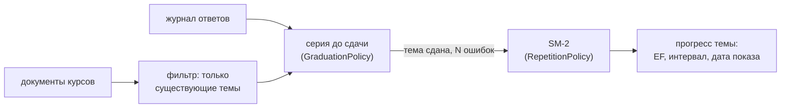

# Архитектура Polylingy

Целевая архитектура приложения после переезда с Flutter на Kotlin Multiplatform. Документ описывает **куда мы идём**; как переписать текущее приложение — в [migration-plan.md](migration-plan.md).

Статус: черновик, октябрь 2026. Решения, помеченные «не решено», сознательно отложены.

---

## 1. Что это за приложение

Polylingy — приложение для обучения с интервальным повторением, как Anki, но с упором на гибкость упражнений и правил повторения.

- Работает **офлайн**: все данные пользователя лежат локально.
- Курсы состоят из **тем**, тема — из нескольких **упражнений**. Повторяется тема, а упражнение внутри неё каждый раз выбирается случайно.
- В будущем: несколько устройств и синхронизация через сервер.

## 2. Главные принципы

1. **Одна бизнес-логика на все платформы.** Правила обучения пишутся один раз в модуле `core` и одинаково работают на десктопе, телефоне и сервере.
2. **Ядро ни от чего не зависит.** В `core` нет UI, SQL, HTTP и файлов. Всё внешнее ядро получает через интерфейсы (порты), а реализации дают платформы.
3. **Два вида данных:**
   - **контент** (курсы, темы, упражнения) — изменяемые документы с версией;
   - **обучение** (ответы пользователя) — неизменяемый журнал событий.
4. **Прогресс не хранится, а вычисляется** из журнала текущими правилами. Поменял правила — пересчитал историю.
5. **Сначала просто.** Делаем то, что нужно сейчас. Будущие возможности описаны концептуально и не реализуются заранее.

## 3. Модули



Стрелка — «зависит от». Все зависимости направлены к `core`.

| Модуль | Язык / технология | Что внутри | Состояние |
|---|---|---|---|
| `core` | Kotlin Multiplatform | модели контента и журнала, правила (SM-2, сдача темы, выбор темы, проверка ответа), `replay()`, порты | делаем сейчас |
| `client` | Kotlin Multiplatform, SQLDelight | реализации портов: курсы и журнал в SQLite, импорт и экспорт JSON | делаем сейчас |
| `app` | Compose Multiplatform | экраны, ViewModel, навигация, сборка объектов, точки входа платформ | делаем сейчас, только десктоп |
| `server` | Java (версия и фреймворк не выбраны, хочется лёгкое) | REST, хранение журналов и курсов, приём синка | только концепция |
| веб | не выбрано | — | только концепция |

Корневой пакет — `com.polylingy` (`com.polylingy.core`, `com.polylingy.client`, `com.polylingy.app`).

### Структура репозитория

```
polylingy/
├── settings.gradle.kts, build.gradle.kts, gradle/libs.versions.toml, gradlew
├── core/src/commonMain/kotlin/com/polylingy/core/
│   ├── content/     Course, Topic, Exercise, CourseService (редактирование документов)
│   ├── journal/     EventEnvelope, Event, AnswerSubmitted, ZonedInstant
│   ├── rules/       Sm2Policy, GraduationPolicy, TopicPicker, AnswerChecker
│   ├── progress/    replay(), TopicProgress, отбор тем на сегодня
│   ├── study/       сценарии использования: StudyService
│   └── ports/       CourseRepository, EventLog, Clock
├── core/src/commonTest/
├── client/src/{commonMain, desktopMain}/
├── app/src/{commonMain, desktopMain}/
└── docs/
```

Папки для Android, iOS, сервера и веба появятся только тогда, когда до них дойдёт работа.

## 4. Ядро и порты

Ядро объявляет, **что** ему нужно от внешнего мира, но не знает, **как** это устроено:

```kotlin
interface CourseRepository {
    fun all(): List<Course>
    fun get(id: Uuid): Course?
    fun save(course: Course)          // увеличивает revision
    fun delete(id: Uuid)
}

interface EventLog {
    fun append(event: EventEnvelope)
    fun all(): List<EventEnvelope>
}

interface Clock {
    fun now(): ZonedInstant           // момент + часовой пояс устройства
}
```

Реализации живут вне ядра: на клиенте это SQLite (`client`), на сервере будет своя БД. В тестах ядра используются реализации в памяти.

Сценарии использования (например, «ответить на упражнение», «получить темы на сегодня») — тоже часть ядра. Они склеивают правила и порты, и экраны вызывают только их.

## 5. Контент: документы курсов

Курс — это **документ**: один целостный объект, который сохраняется целиком.

```kotlin
data class Course(
    val id: Uuid,
    val name: String,
    val createdAt: Instant,
    val revision: Int,            // +1 при каждом сохранении
    val updatedAt: Instant,
    val topics: List<Topic>,
)

data class Topic(
    val id: Uuid,                 // стабилен: удаление соседей его не меняет
    val subject: String,
    val explanation: Explanation?,
    val exercises: List<Exercise>,
)

data class Exercise(
    val id: Uuid,
    val task: String,             // с пропусками {0}, {1}
    val answers: Map<String, String>,
    val explanation: String?,
)
```

- **Все id — UUID.** Они уникальны без координации, это нужно для синхронизации между устройствами.
- **Версионирование:** `revision` растёт при каждом сохранении, `updatedAt` — для человека и на случай равных ревизий.
- **Конфликты (когда появится синк):** побеждает документ с большей `revision`, при равенстве — с более поздним `updatedAt`. Документ заменяется целиком, без слияния по полям.
- **Хранение на клиенте:** в SQLite рядом с журналом. Ручное редактирование — через экспорт в JSON, правку и импорт.
- **Формат JSON** для импорта и экспорта совместим с текущими файлами Flutter-версии. Недостающие id и версии при импорте генерируются.

## 6. Обучение: журнал событий

Каждый ответ пользователя — это событие, которое дописывается в журнал и **никогда не меняется**.

```kotlin
data class EventEnvelope(
    val eventId: Uuid,            // уникален: повторная отправка при синке не создаст дубль
    val deviceId: Uuid,
    val occurredAt: ZonedInstant,
    val schemaVersion: Int,
    val event: Event,
)

// Аналог java.time.ZonedDateTime, доступный на всех платформах
data class ZonedInstant(val instant: Instant, val zone: TimeZone)

sealed interface Event

data class AnswerSubmitted(
    val courseId: Uuid,
    val topicId: Uuid,
    val exerciseId: Uuid,
    val input: String,            // что ввёл пользователь — храним всегда
    val autoCheck: AutoCheck?,    // null, если у упражнения нет автопроверки
    val rating: Rating?,          // null, если в курсе нет самооценки
) : Event

enum class AutoCheck { CORRECT, PARTIAL, INCORRECT }

// Шкалу задаёт курс, а не код: ("binary", "correct"), в будущем ("anki4", "hard") и т. п.
data class Rating(val scale: String, val value: String)
```

Правила журнала:

- **Событие неизменяемо.** Ошибки исправляются новыми событиями, а не правкой старых.
- **Формат развивается через `schemaVersion`.** Старые версии всегда должны читаться (переводятся в текущую при чтении).
- **Тип события пока один** — `AnswerSubmitted`. Новые типы добавляются, только когда появляется функция, которой они нужны.
- **Время с часовым поясом** (`ZonedInstant`). Так «какой это был день» вычисляется одинаково на любом устройстве и на сервере, даже если пользователь сменил пояс.
- **Удаление курса или темы не трогает журнал.** События удалённого контента просто игнорируются при пересчёте.

## 7. Как вычисляется прогресс

Прогресс по теме полностью выводится из журнала:



1. **Отбор.** Берутся ответы по темам, которые есть в текущих документах курсов. Ответы, отсортированные по времени, группируются по теме.
2. **Верен ли ответ.** Решает самооценка (`rating`). Если её нет — автопроверка: верным считается только `CORRECT`. Правило вынесено в отдельную функцию, чтобы его можно было менять.
3. **Сдача темы — серия до сдачи.** Тема сдана после 3 верных ответов подряд. Неверный ответ обнуляет серию и увеличивает счётчик ошибок. Серия **не сбрасывается** ни выходом с экрана, ни сменой дня: она живёт, пока тема не будет сдана.
4. **SM-2.** Когда тема сдана, число ошибок превращается в оценку и меняет ease factor и интервал. Таблица — как в текущем приложении: 0 ошибок → q = 5, EF +0.1; 1 → q = 4, EF без изменений; 2 → q = 3, EF −0.15; 3+ → q = 2, EF −0.3 и интервал 1 день; EF не ниже 1.3. После сдачи серия и ошибки начинаются заново.
5. **Доступна ли тема сегодня.** Новая тема (ещё ни разу не сдана) доступна всегда. Сданная — если дата следующего показа сегодня или раньше. «Сегодня» — по часовому поясу устройства.

```kotlin
fun replay(courses: List<Course>, events: List<EventEnvelope>, rules: Rules): Map<Uuid, TopicProgress>
```

> **TODO(perf): узкое место.** Сейчас при каждом запросе прогресса весь журнал пересчитывается с нуля. Это просто и всегда правильно, но станет медленным, когда событий будут десятки тысяч. Замена — проекция: таблица текущего прогресса, которая обновляется по мере появления событий и которую в любой момент можно пересобрать из журнала.

## 8. Клиент: хранение

- **SQLite через SQLDelight.** Схема пишется на SQL, Kotlin-код генерируется.
- **Таблицы:**
  - `course_document` — курс целиком как JSON плюс `id`, `revision`, `updated_at`;
  - `journal_event` — конверт события: `event_id`, время, пояс, `schema_version`, тип и тело события в JSON;
  - `setting` — настройки установки, например `deviceId` для событий.

  Хранение тел в JSON позволяет развивать формат событий без миграций таблиц.
- **Импорт и экспорт JSON** — обычные файлы курсов в формате, совместимом с текущим. Пример курса импортируется при первом запуске.
- **Схема клиентской БД — не общая с сервером.** Общим является только формат данных (модели и JSON событий и документов), который описан в `core`.

## 9. Приложение: экраны и платформы

- **Экраны на Compose Multiplatform**, общие для всех клиентских платформ.
- **Состояние экранов** — официальные `ViewModel` и Navigation для Compose Multiplatform.
- **Сборка объектов** — вручную в одном классе `AppContainer`, без DI-фреймворка.

Граница общего и платформенного кода:

| Слой | Общий код | Платформенный код |
|---|---|---|
| Экраны и навигация | ✓ | — |
| ViewModel, вызов ядра | ✓ | — |
| Хранилище, импорт/экспорт | ✓ (логика) | драйвер SQLite, пути к файлам, диалог выбора файла |
| Точка входа | — | `main()` и окно на десктопе; позже Activity, iOS-обёртка |
| Сборка | — | `.msi` / `.dmg` / `.deb`, позже `.apk` / `.ipa` |

**Сейчас поддерживается только десктоп**, а собирается и проверяется — только Windows. Код десктопа один для Windows, macOS и Linux; различаются установщики, и каждый собирается на своей ОС.

**В будущем (концепция):**

- **Android** — тот же `app` и `client` плюс `androidMain`.
- **iOS** — то же через Kotlin/Native плюс Xcode-обёртка. Нужен Mac.
- **Веб** — технология не выбрана. Возможные пути: тонкий клиент к серверу или ядро, скомпилированное в JS.

## 10. Сервер и синхронизация (концепция)

Сервер **не реализуется** на текущем этапе. Зафиксированы только идеи:

- Сервер на Java. Фреймворк не выбран, предпочтение — лёгкие библиотеки, а не полный фреймворк. Ядро подключается как обычная JVM-библиотека.
- **Журнал синхронизируется дописыванием.** Клиент отправляет события, которых нет на сервере, и получает новые с других устройств. Сервер нумерует принятые события по порядку, а клиент запрашивает «всё после номера N». Дубли отсекаются по `eventId`. Конфликтов нет.
- **Курсы синхронизируются целиком** по правилу из раздела 5.
- Прогресс вычисляется тем же `replay()` и на клиенте, и на сервере.

## 11. Узкие места и долги

| Что | Почему пока так | Чем заменить |
|---|---|---|
| Полный пересчёт журнала при каждом запросе | проще всего и всегда верно | проекция прогресса, пересобираемая из журнала |
| Удалённые курсы физически удаляются из `course_document` | синка пока нет | метка «удалён» (tombstone), чтобы удаление доезжало до других устройств |
| Ответы на несколько пропусков вводятся через запятую | паритет с текущей версией | отдельное поле на каждый пропуск или другой тип упражнения |
| События удалённого контента остаются в журнале навсегда | журнал неизменяем | чистка, если понадобится |

## 12. Не решено

- **Типы упражнений и шкалы оценки.** Сейчас одно упражнение «впиши ответ» и шкала `binary`. Будущая гибкость (курсы без самооценки, свои кнопки, другие упражнения) ляжет на необязательные `autoCheck` и `rating` и на настройки курса, но конкретного видения пока нет.
- **Настройки правил на уровне курса** — какие политики использует курс.
- **Сервер:** версия Java, фреймворк, БД, авторизация.
- **Веб:** технология и роль (тонкий клиент или офлайн-клиент).
